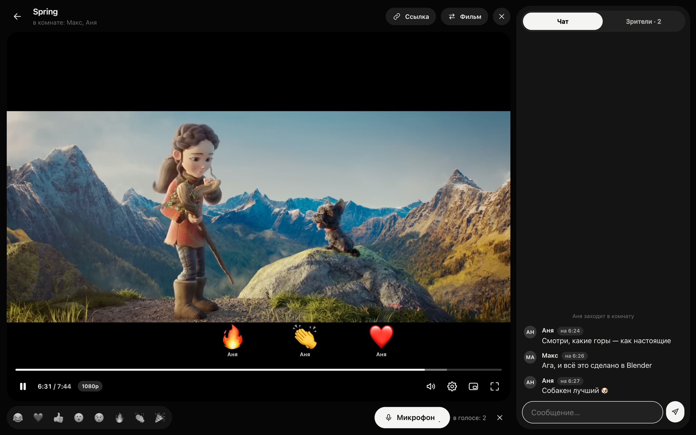
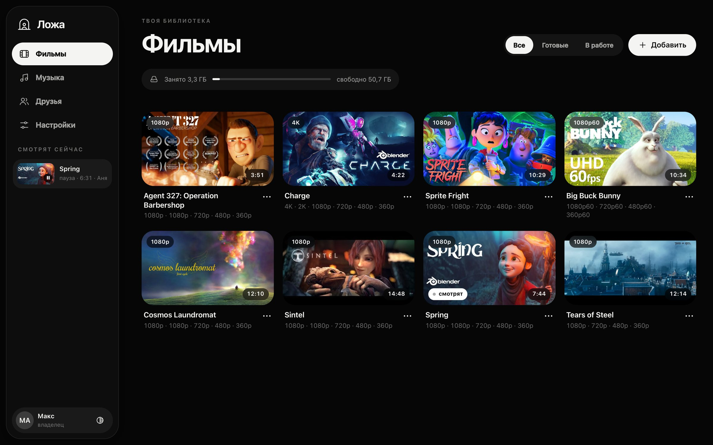
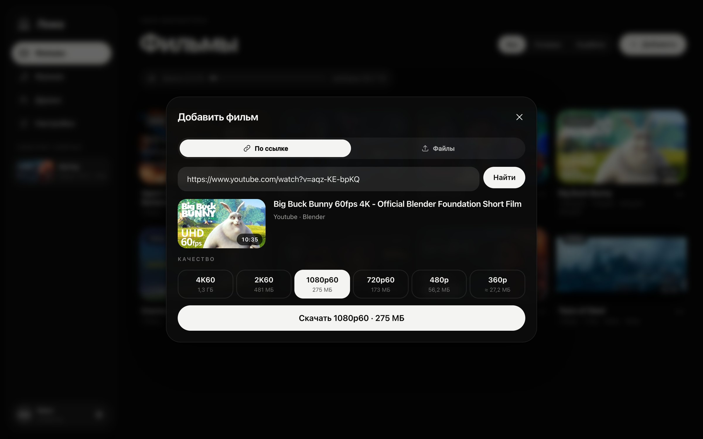
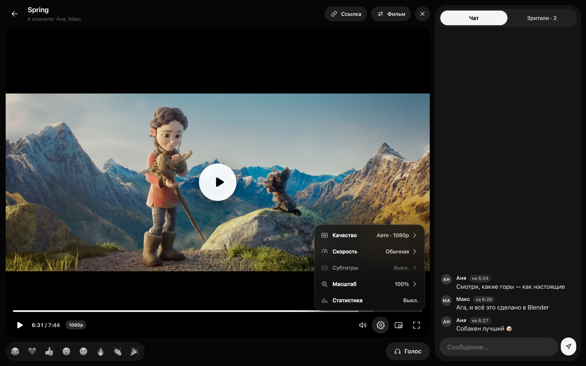
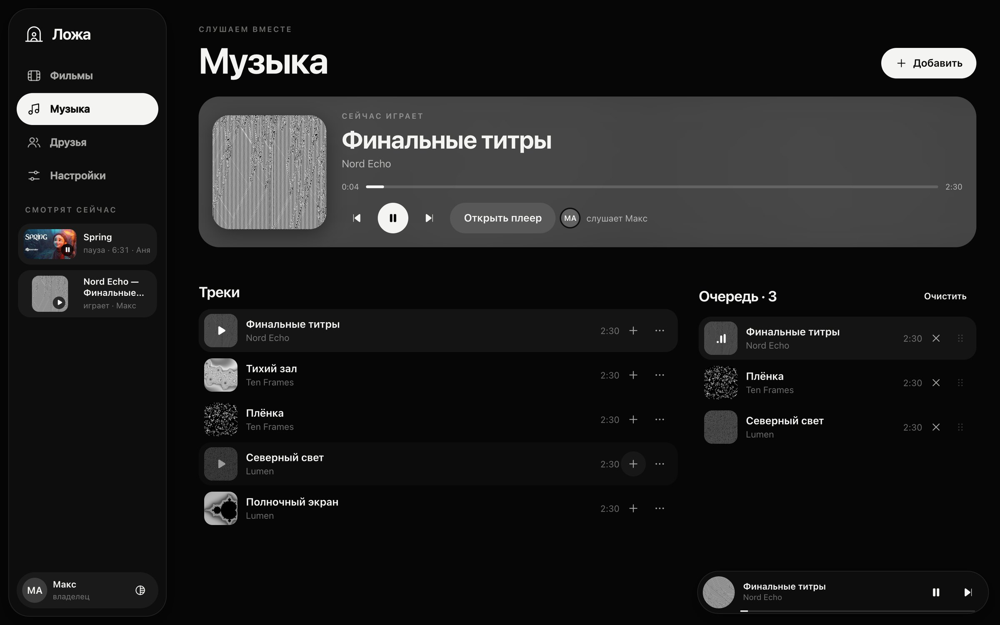
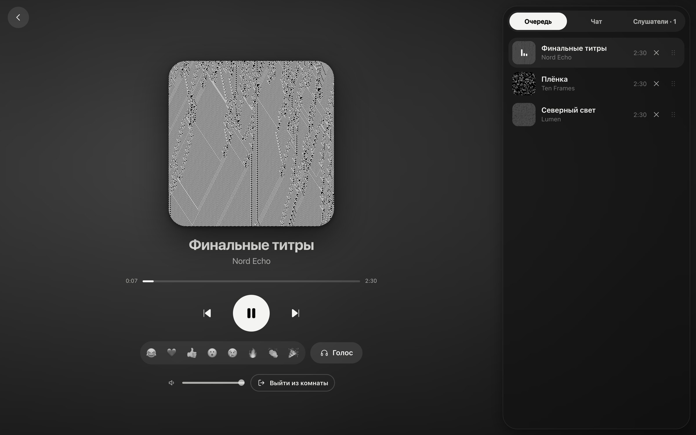
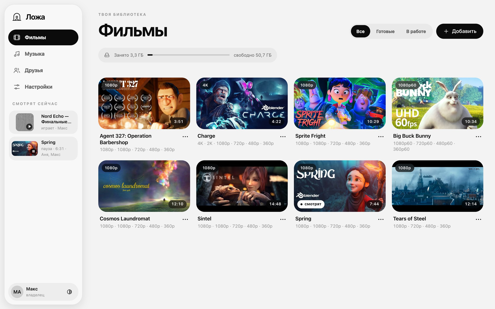
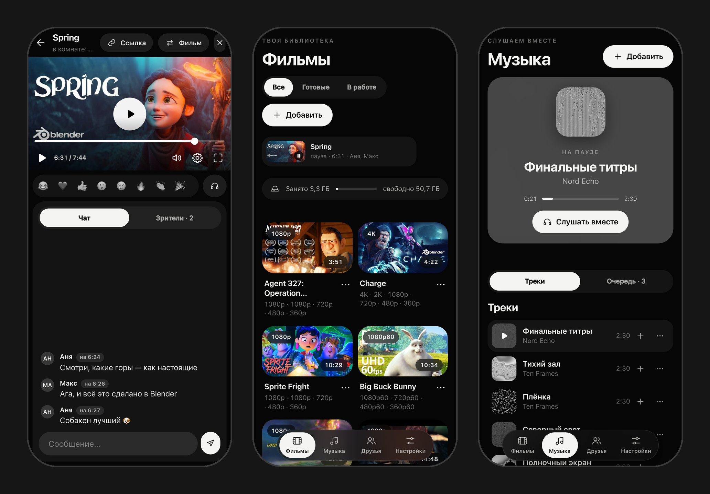

<div align="center">


# Ложа

**Свой маленький кинозал: фильмы и музыка вместе с друзьями — на своём сервере.**

*A tiny self-hosted cinema: watch movies and listen to music together with friends.*


<br>



</div>

---

Загружаешь фильм файлом или по ссылке, зовёшь друзей — и смотрите синхронно: пауза и перемотка у всех одновременно, рядом чат и голос. То же самое с музыкой. Всё живёт на твоём компьютере или сервере, без чужих облаков.

> [!NOTE]
> Проект целиком написан нейросетью по одному промпту — он лежит в [PROMPT.md](PROMPT.md).

## Возможности

### 🎬 Фильмы
- **Загрузка файлом** — любой формат (MP4, MKV, AVI, MOV, WEBM…) и размер, хоть десятки гигабайт: кусками по 8 МБ, несколько кусков параллельно, докачка после обрыва связи и перезагрузки страницы. Можно просто перетащить файл в окно.
- **Загрузка по ссылке** — YouTube (обычные видео, Shorts, ссылки из плейлистов), Rutube, VK Видео и всё, что умеет [yt-dlp], плюс страницы со встроенным плеером, `.m3u8` и прямые ссылки на файлы. Перед скачиванием видно превью, длительность и все качества с размерами.
- **Без потери качества** — что браузеры играют, остаётся как есть; остальное ffmpeg приводит к H.264/AAC. Субтитры, постер и русская дорожка — автоматически.
- **Версии качества** — 360p, 480p, 720p, 1080p, 2K, 60 кадров остаются 60. Для видео по ссылке готовые H.264-версии берутся прямо с сайта, пересжимается только недостающее.

### 🍿 Вместе
- **Комнаты** — пауза, перемотка и скорость синхронны у всех; если у кого-то подгружается, комната ждёт.
- **Чат** с отметкой момента фильма и **реакции** поверх видео.
- **Голосовой чат** на WebRTC; пока кто-то говорит, фильм чуть тише.
- **«Смотрят сейчас»** — друзья видят, что идёт, и заходят одной кнопкой.

### ▶️ Плеер
- Качество (с «Авто», которое само спускается ступенькой при подвисаниях), масштаб, скорость, субтитры, статистика трансляции.
- Полный экран, картинка в картинке, горячие клавиши, двойной тап на телефоне.
- Сам понимает, какой кодек браузер не тянет, и включает совместимую версию.

### 🎧 Музыка вместе
- Треки файлом или по ссылке, обложки и теги.
- Общая очередь, синхронное прослушивание, мини-плеер, который не прерывается при переходах, и экран «Сейчас играет».

### 🔒 Доступ
- Владелец и друзья: регистрация только по одноразовым приглашениям (7 дней).
- Пароли в scrypt, сессии в httpOnly-cookie, защита от перебора и от запросов во внутреннюю сеть при загрузке по ссылке.
- Видео и музыка отдаются только после проверки доступа.

### 🖤 Интерфейс
Чёрно-белый, тёмная и светлая темы, стекло, плавные переходы, свои иконки. Одинаково удобно на телефоне и на большом мониторе.

## Скриншоты

<table>
<tr>
<td width="50%"><br><sub><b>Библиотека</b> — качества каждого фильма и «Смотрят сейчас»</sub></td>
<td width="50%"><br><sub><b>По ссылке</b> — все качества с размерами до скачивания</sub></td>
</tr>
<tr>
<td><br><sub><b>Плеер</b> — качество, скорость, субтитры, масштаб, статистика</sub></td>
<td><br><sub><b>Музыка</b> — треки, общая очередь, мини-плеер</sub></td>
</tr>
<tr>
<td><br><sub><b>Сейчас играет</b> — слушаем вместе, с чатом и голосом</sub></td>
<td><br><sub><b>Светлая тема</b> — по системе или вручную</sub></td>
</tr>
</table>

<p align="center"></p>

<sub>На скриншотах — открытые фильмы Blender Studio (Spring, Sintel, Charge, Sprite Fright и др., лицензия CC BY), скачанные самим сайтом по ссылкам с YouTube. Музыка — сгенерированные демо-треки.</sub>

## Быстрый старт

Нужны **Node.js 22+** и **ffmpeg** (`brew install ffmpeg`, `sudo apt install ffmpeg` или `winget install Gyan.FFmpeg`). yt-dlp ставить не нужно — `npm install` сам положит официальный в `./bin`, если его нет в системе.

```bash
git clone <ссылка на этот репозиторий> lozha
cd lozha
npm install
npm start
```

Открой **http://localhost:3000** и войди:

| Логин | Пароль |
| --- | --- |
| `Пользователь` | `12345678` |

> [!IMPORTANT]
> Смени пароль сразу после первого входа: «Настройки» → «Профиль». Логин и пароль первого запуска можно задать заранее через `LOZHA_OWNER` и `LOZHA_OWNER_PASSWORD`.

Друзей зови через «Друзья» → «Пригласить»: ссылка одноразовая. В консоли при старте есть и адрес в локальной сети — для телефона.

### Голос с телефона: HTTPS

Браузеры дают микрофон только по HTTPS (кроме `localhost`). Для локальной сети есть режим с самоподписанным сертификатом:

```bash
npm run https
```

Откроется ещё и `https://…:3443`. Браузер один раз предупредит о сертификате — «Дополнительно» → «Перейти на сайт».

## Где что

| Что | Где |
| --- | --- |
| Добавить фильм | «Фильмы» → «Добавить» (или перетащи файл в окно) |
| Позвать друга | «Друзья» → «Пригласить» |
| Смотреть вместе | нажми на фильм — откроется комната |
| Голос | в комнате «Голос» → «Микрофон» |
| Качество, скорость, субтитры, масштаб, статистика | шестерёнка в плеере |
| Музыка | «Музыка» → ▶ на треке, «+» — в общую очередь |
| Видео, для которых сайт просит вход | «Настройки» → «Сервер» → cookies.txt |
| yt-dlp | обновляется сам; вручную — «Настройки» → «Сервер» |
| Тема | «Настройки» → «Оформление» |

**Клавиши в плеере:** `Пробел` — пауза, `←`/`→` — ±5 с (с `Shift` — ±30 с), `↑`/`↓` — громкость, `F` — полный экран, `M` — без звука. На телефоне двойной тап по краям — ±10 с.

## Настройки

Всё задаётся переменными окружения, по умолчанию ничего настраивать не нужно.

| Переменная | По умолчанию | Что делает |
| --- | --- | --- |
| `PORT` | `3000` | порт сайта |
| `HTTPS_PORT` | `3443` | порт HTTPS-режима |
| `HOST` | `0.0.0.0` | на каком адресе слушать (`127.0.0.1` — только этот компьютер) |
| `LOZHA_DATA` | `./data` | база, фильмы, музыка, временные файлы |
| `LOZHA_BIN` | `./bin` | где лежит yt-dlp |
| `LOZHA_OWNER` | `Пользователь` | логин владельца при первом запуске |
| `LOZHA_OWNER_PASSWORD` | `12345678` | пароль владельца при первом запуске |
| `LOZHA_TRUST_PROXY` | — | `1`, если сайт стоит за nginx |
| `LOZHA_ACCEL` | — | отдача файлов через nginx, например `/_media/` |

## Свой сервер

В `deploy/` лежит всё для Ubuntu/Debian с nginx: сервис systemd с песочницей, пример конфига nginx (файлы отдаёт сам nginx после проверки доступа в Node) и скрипт выкатки.

```bash
# на сервере, один раз
sudo useradd --system --home /var/lib/lozha --shell /usr/sbin/nologin lozha
sudo mkdir -p /var/www/lozha /var/lib/lozha && sudo chown lozha:lozha /var/lib/lozha
sudo cp deploy/lozha.service /etc/systemd/system/ && sudo systemctl enable lozha
sudo cp deploy/nginx.conf.example /etc/nginx/sites-available/lozha   # поменяй example.com на свой домен
sudo ln -s /etc/nginx/sites-available/lozha /etc/nginx/sites-enabled/ && sudo nginx -t && sudo systemctl reload nginx

# с компьютера — каждый раз, когда обновляешь код
DEPLOY_HOST=user@your-server ./deploy/deploy.sh
```

После первой выкатки поставь yt-dlp к данным сервиса и запусти его:

```bash
cd /var/www/lozha && sudo -u lozha env LOZHA_BIN=/var/lib/lozha/bin node scripts/setup.mjs
sudo systemctl start lozha
```

## Как устроено

```
server/    Node.js без фреймворков: HTTP, WebSocket (ws), SQLite (node:sqlite), очереди ffmpeg и yt-dlp
public/    интерфейс на чистом JS и CSS, без сборки
scripts/   установка yt-dlp
deploy/    systemd, nginx, выкатка
data/      база и файлы — создаётся при первом запуске, в git не попадает
```

Живые события идут по WebSocket, а если он недоступен — по SSE. Видео обрабатывает ffmpeg в фоне: фильм можно смотреть сразу, версии качества появляются по мере готовности.

[yt-dlp]: https://github.com/yt-dlp/yt-dlp
